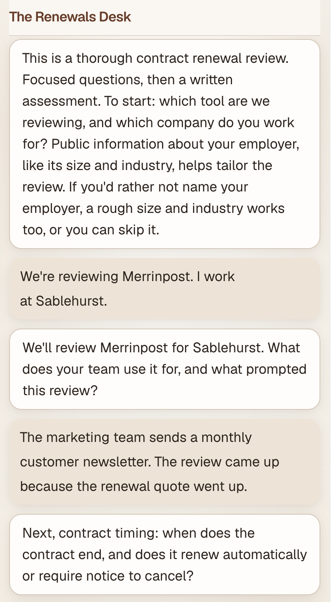

# The Renewals Desk

**Live product:** [https://www.therenewalsdesk.com](https://www.therenewalsdesk.com)

The Renewals Desk helps marketing operations and martech leaders decide what to do about one SaaS or marketing technology renewal at a time. Someone reviewing a tool brings the ownership, usage, cost, dependency, and contract facts they have. The desk asks focused follow-ups, then writes a short assessment with a clear next step.

The line on the page: An AI-powered assistant for marketing technology leaders deciding whether to renew, replace, or deprecate a tool or platform in their stack.

This repository is the public portfolio showcase: the product narrative and the architecture. The application source is private.


The opening message is a thorough contract renewal review: focused questions, then a written assessment, starting with which tool is under review. The user may optionally share industry and approximate employee count. The desk does not ask for a company name or website, and it does not look up the user's employer. Vendor research is the only public web lookup, and it runs after use cases and any overlap candidate are known.



Questions stay short: usually two distinct asks per reply, never more than three. Contract timing comes before cost. Notice deadlines and the related commercial figures are calculated in application code. The tool in the screenshot is fictional. No company name appears.

---

## Problem

A renewal is difficult to call when the evidence is incomplete and split across Marketing Ops, IT, Finance, Procurement, and Legal. Overlapping features, on their own, do not show that a tool can come out safely. The person making the decision needs a timely recommendation that is plain about confidence, tradeoffs, and what still has to be confirmed.

## What it does

The work runs in separate passes: chat intake, evidence extraction, vendor research, and a formal assessment.

1. **Intake conversation.** The chat opens with this:

   > This is a thorough contract renewal review where you'll be asked focused questions and then given a written assessment. Which tool are we reviewing? If you'd like, share your company's industry and approximate employee count to help tailor the review.

   Industry and size are optional and stored as user-stated context. The desk does not ask for an employer name or website, and it does not research the user's company. From there it gathers purpose, ownership, commercial terms, usage, dependencies, overlap candidates, and vendor context. Each reply defaults to two distinct asks and never exceeds three. Commercial timing (end date and auto-renew or notice) is asked before cost and seats. Later turns go straight to a short topic label without restating the previous answer. A follow-up is asked when the answer could change the recommendation. Answers are typed or pasted text.

2. **Structured evidence.** The session holds an evidence record. Each fact has a value, a source, and a state: answered, user does not know, conflicting, or not yet asked. A contract term that was never supplied stays not yet asked; an answer the user cannot provide is recorded separately. Extract and research updates run one at a time from the latest committed record, so fast replies do not overwrite earlier facts before the assessment. Conflicting contract dates or notice terms remain unresolved until corrected. A calculated deadline stays separate from user-supplied evidence.

3. **Vendor research.** Once use cases and any overlap candidate are known, the desk researches current public product capabilities and writes the findings into the evidence record with sources. It does not look up the buyer's company. The chat stays a conversation.

4. **Deadline math.** Notice deadlines and runway are calculated in deterministic application code, using the user's local calendar date, and shown when the timing matters. The language model does not do that arithmetic. The first reply with enough timing information includes the calculated deadline, even before background extraction finishes. A usage window is not treated as a notice period. Once Procurement or Legal is checking the terms with an expected response time, the desk avoids repeatedly asking for the same confirmation.

5. **Handoff and formal assessment.** When intake is ready, the chat handoff is one short sentence (for example, "Thanks, that's everything I need. I'll write up the assessment now."). A separate assessment pass then writes a compact review:
   - **Immediate contract action:** renew, renegotiate, seek an extension, defer, or do not renew
   - **Longer-term direction:** retain, sunset, consolidate, or investigate further
   - **Reasoning and evidence:** the case for the call, with a status of supported, provisional, or insufficient information
   - **Action plan:** owners and next steps

   The assessment waits for pending evidence updates and vendor research. A final transcript check can fill required facts that extraction missed. Copy assessment pastes formatted text (headings and lists) suitable for another document. There is no trailing Sources list.

6. **Revision.** New evidence updates the recommendation. Older assessments in the thread are marked superseded.

The session is not saved after the tab closes. Organizational approval stays with the person using the desk.

**Privacy.** The [Privacy and Data](https://www.therenewalsdesk.com/privacy) page describes what happens to a conversation in practice. Storage and logging are turned off for this site's OpenAI requests, so conversations are not kept in this site's OpenAI account, and OpenAI does not use API data to train its models. Under its standard API terms, OpenAI may still keep request content for up to 30 days for abuse monitoring. The site does not have a zero-retention arrangement with OpenAI. The site uses no cookies, tracking, or analytics.

---

## Architecture

```text
┌─────────────────────────────────────────────────────────┐
│  Browser (Next.js App Router UI)                        │
│  • Single-column chat shell                             │
│  • In-memory session evidence and messages              │
│  • Serial background extract/research commits           │
│  • Displays complete replies and assessments            │
└───────────────────────────┬─────────────────────────────┘
                            │
                            ▼
┌─────────────────────────────────────────────────────────┐
│  API layer                                              │
│  • Chat          → complete intake replies              │
│  • Extract       → structured evidence updates          │
│  • Research      → vendor / product capability research │
│  • Reconcile     → missing required-fact check          │
│  • Assess        → formal assessment generation         │
│  • Bot-focused rate limits on public API routes         │
└───────────────────────────┬─────────────────────────────┘
                            │
                            ▼
┌─────────────────────────────────────────────────────────┐
│  Domain logic                                           │
│  • Evidence merge and conflict handling                 │
│  • Commercial terms and notice-deadline calculation     │
│  • Assessment readiness and handoff                     │
│  • Role-separated model calls (chat, extract,           │
│    research, assessment), chosen in configuration       │
└─────────────────────────────────────────────────────────┘
```

**Design choices that shape the product:**

| Choice | Why |
|--------|-----|
| Intake and assessment are separate passes | Questions stay investigative. The written assessment stays compact and consistent. |
| Short ask groups, timing before cost | Usually two asks per reply, never more than three. Contract timing is asked before spend. |
| Deadline arithmetic is deterministic | Date math runs in application code, on the user's local calendar date. |
| Vendor research lands in the evidence record | The conversation stays readable, and the recommendation still has sources. The buyer's company is not researched. |
| Background evidence updates are serial | Fast pasted answers still land in the record before the assessment runs. |
| Session-only state | One review in the open tab, with no account and no saved transcript. |
| One tool per review | The conversation stays on that renewal. Overlap comes up when it changes the call. |

---

## Features

- A renewal conversation for one B2B marketing technology decision
- A warm desk palette (mahogany and ivory) and a clear brand hierarchy
- Complete replies and assessments revealed after a visible waiting state
- Markdown rendering for assistant replies
- An in-session evidence record across the intake categories
- Optional industry and size as user-stated context, with no company lookup
- Vendor research at milestones, stored with sources
- A notice deadline and runway from application code when the inputs are known
- A one-sentence handoff into the formal assessment
- A four-section assessment with formatted copy to clipboard
- A plain status on the recommendation: supported, provisional, or insufficient information
- Safeguards on invented contract terms, on reading low utilization as low value, and on consolidation before workflow and capacity are checked
- Bot-focused rate limits on the public API routes, high enough for a person reviewing many tools

**Outside the product:** file uploads, live account connectors, vendor outreach, contract execution, whole-stack audits, employer research, and replacing organizational approval.

---

## Tech stack

| Layer | Technology |
|-------|------------|
| Framework | Next.js 16 (App Router) |
| UI | React 19, TypeScript, Tailwind CSS 4 |
| Models | OpenAI API. Chat uses GPT-6.1 Terra at high reasoning effort. Research uses GPT-6.1 Terra at medium. Extraction and final evidence reconciliation use GPT-6.1 Terra with configurable reasoning effort through `OPENAI_EXTRACTION_REASONING_EFFORT`, currently medium, with an explicit medium fallback in application code. Assessment uses GPT-6.1 Sol with configurable reasoning effort, currently medium, and a medium fallback. GPT-6 Astra is unused unless chosen for a role. Reasoning effort is a separate dial. Requests set `store: false`. |
| Response display | Complete messages after generation, with a short fade-in. The composer stays available during background evidence work. |
| Markdown | `react-markdown` |
| Quality | ESLint and 109 automated tests covering deadline math, contract evidence, assessment copy, research merge, reconciliation, serial background evidence updates, reasoning-effort configuration, and native paste handling |
| Deploy | Vercel |

---

## Product principles

- Help a leader decide on one existing tool's renewal.
- Weigh business value, total cost, operating capacity, and a feasible next action ahead of architecture labels or a feature checklist.
- Ask a follow-up only when the answer could materially change the recommendation. Keep each reply to a few distinct asks, and put contract timing ahead of cost.
- State assumptions, unknowns, and a provisional status in everyday language.
- Keep the assessment short enough to read in about a minute.

---

## Portfolio note

Source code, prompts, and the detailed decision method are proprietary. They are not in this showcase.

Drafted with AI from the product and the codebase, then reviewed by a human. This is AI-assisted copy.

**Try the live app:** [therenewalsdesk.com](https://www.therenewalsdesk.com)
